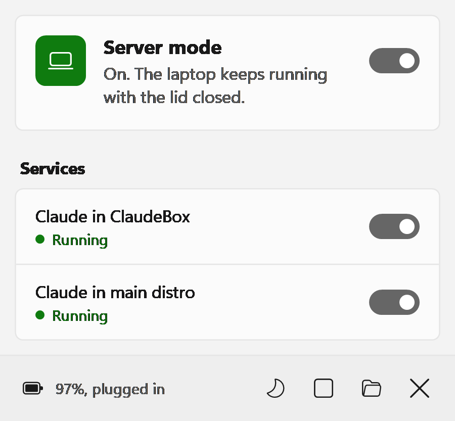

# Laptop Server Mode

[](LICENSE)


Turn a Windows laptop into a small always-on server with one click, and back
into a laptop with another. While server mode is on, the laptop keeps working
with the lid closed, survives restarts (even before anyone signs in) and keeps
your own programs running. Your normal power settings are never edited.

<picture>
  <source media="(prefers-color-scheme: dark)" srcset="docs/images/flyout-dark.png">
  
</picture>

## Contents

- [Features](#features)
- [What it doesn't do](#what-it-doesnt-do)
- [Requirements](#requirements)
- [Quick start](#quick-start)
- [Usage](#usage)
- [Configuration](#configuration)
- [Plugins](#plugins)
- [Add-ons](#add-ons)
- [Remote access](#remote-access)
- [Troubleshooting](#troubleshooting)
- [Documentation](#documentation)
- [Contributing](#contributing)
- [License](#license)

## Features

- **One click.** Left-click the tray icon to turn server mode on or off. Right-click for a flyout with the status of everything it runs.
- **Lid closed, no sleep.** While on, closing the lid and idle timers don't sleep the laptop. The screen still turns off.
- **Your settings stay yours.** Turning it on copies your current power plan into a temporary one; turning it off switches back and deletes the copy.
- **Battery safe.** On battery it pauses at 35% (configurable) and resumes when you plug in.
- **Survives restarts.** A background watchdog brings server mode and your programs back after a reboot or Windows Update, before anyone signs in.
- **Keeps your programs running.** Plugins keep a command running (a bot, a file server, an agent) and run scripts on boot, shutdown or state changes, with automatic restarts and backoff.
- **Windows or Linux.** Plugins run as PowerShell or Windows commands, or as bash in any WSL distro. WSL is optional.
- **No admin, no stored password.** Installs per user. The background tasks use Windows' "do not store password" mode.
- **Native look.** Windows 11 style tray UI with light and dark themes, your accent color, high DPI and keyboard navigation.

## What it doesn't do

Laptop Server Mode is deliberately small. It does **not**:

- **Give you remote access.** Pair it with Tailscale, ZeroTier, SSH or Chrome Remote Desktop (see [Remote access](#remote-access)).
- **Sandbox your programs.** Plugins run as you, with your permissions. Only the optional [Claude Remote](addons/claude-remote/) add-on isolates anything (in its own WSL distro).
- **Stop Windows Update restarts.** It comes back on its own afterwards.
- **Limit battery charging.** Use your laptop vendor's tool (Lenovo Vantage, Dell Power Manager, ...).
- **Show anything before sign-in.** The tray appears when you sign in; until then everything runs in the background.
- **Run GUI programs in the background.** Background services run in Windows' service session (session 0), so they can't show windows.
- **Run on macOS or Linux hosts.**

Things to know:

- Power-setting changes you make while server mode is on go to the temporary plan and are discarded when you turn it off.
- Until someone signs in to Windows, Windows can't see WSL's files, and WSLg (Linux GUI apps, the microphone) isn't available to distros started then.
- Shutdown hooks are best effort: Windows doesn't wait for them.
- Tested on Windows 11 Home laptops with Modern Standby. Desktops should work (the battery rule then never applies) but aren't tested.

## Requirements

- Windows 10 or 11
- Windows PowerShell 5.1 (built in)
- Optional: [WSL 2](https://learn.microsoft.com/windows/wsl/install), for plugins that run in Linux and for the Claude add-on's ClaudeBox
- No admin rights (if Windows insists, the installer asks for them)

## Quick start

From PowerShell, in the folder you downloaded or cloned:

```powershell
git clone https://github.com/rishabhjain08/laptop-server-mode.git
cd laptop-server-mode
powershell -ExecutionPolicy Bypass -File .\install.ps1
```

Or from WSL:

```bash
git clone https://github.com/rishabhjain08/laptop-server-mode.git
cd laptop-server-mode
./install.sh
```

A laptop icon appears next to the clock. Click it to turn server mode on.

- **Update:** pull the repo and run the installer again. Your config, state and plugins are kept.
- **Uninstall:** `uninstall.ps1` (or `./uninstall.sh`). It restores your normal power plan and removes everything.

Each `.sh` script is a thin wrapper for the `.ps1` script of the same name.

## Usage

| To | Do |
| --- | --- |
| Turn server mode on or off | Left-click the tray icon |
| See what's running, switch services | Right-click the tray icon |
| Stop every service at once (kill switch) | Flyout > square button |
| Turn the screen off now | Flyout > moon button |
| Open the logs | Flyout > folder button |
| Hide the tray icon | Flyout > X button |
| Get the tray icon back | Start menu > **Laptop Server Mode** |

The icon has a green badge when server mode is on, amber when it's paused by
the battery rule, and none when it's off.

## Configuration

`%LOCALAPPDATA%\LaptopServerMode\config.json`:

| Key | Default | Meaning |
| --- | --- | --- |
| `batteryLimit` | `35` | On battery, pause server mode at or below this percent |
| `pollSeconds` | `15` | How often the watchdog checks |
| `wslDistro` | the distro `install.sh` ran in; empty from `install.ps1` | Default distro for WSL plugins. Empty means Windows' default WSL distro |

Changes apply on the watchdog's next check.

## Plugins

A plugin is a folder with a `plugin.json`. It can keep a **service** running,
run **hooks** on events, or both. This one keeps a file server running in WSL:

```json
{
  "name": "file-share",
  "title": "File share on port 8080",
  "run": "python3 -m http.server 8080 --directory ~/share"
}
```

Add `"runsIn": "windows"` to run it on Windows instead. Manage plugins with:

```powershell
.\plugin.ps1 add examples\event-log-windows   # install or update
.\plugin.ps1 list                             # where each runs, and why if it can't
.\plugin.ps1 enable|disable <name>            # like the tray switch
.\plugin.ps1 remove <name>                    # stop it and delete it
```

Every service gets a switch and a status in the flyout. A plugin that can't
run on this PC (for example, it needs WSL and WSL isn't installed) shows
**Needs setup**; hover it for the reason.

The full reference covers hooks, settings, environment variables, script services and WSL details: **[docs/PLUGINS.md](docs/PLUGINS.md)**. Examples are in [`examples/`](examples/).

## Add-ons

- **[Claude Remote](addons/claude-remote/)** runs [Claude Code](https://claude.com/claude-code) with Remote Control around the clock, so you can drive it from your phone. It can run in an isolated, locked-down WSL distro (ClaudeBox), in your own WSL distro, or on Windows without WSL.

## Remote access

Laptop Server Mode keeps the laptop working; reaching it is up to you. Options that work well:

- **Tailscale** or **ZeroTier** for a private network to the laptop. To SSH into WSL, use WSL [mirrored networking](https://learn.microsoft.com/windows/wsl/networking#mirrored-mode-networking) and allow the port through the Hyper-V firewall (elevated PowerShell; add `-RemoteAddresses <your network>` to limit who can connect):
  ```powershell
  New-NetFirewallHyperVRule -Name WSL-SSH -DisplayName "WSL SSH" -Direction Inbound `
    -VMCreatorId '{40E0AC32-46A5-438A-A0B2-2B479E8F2E90}' -Protocol TCP -LocalPorts 22
  ```
- **Chrome Remote Desktop** for the Windows desktop. It runs as a service, so it works at the lock screen and after restarts. (Windows Home can't host Windows' own Remote Desktop.)

Tips: don't run it with the lid closed in a bag (it needs airflow), and if it
stays plugged in, set a battery charge limit in your vendor's tool.

## Troubleshooting

| Symptom | What to do |
| --- | --- |
| Anything unexpected | Check the logs: flyout > folder button, or `%LOCALAPPDATA%\LaptopServerMode\logs` (`watchdog.log`, `hooks.log`, `tray.log`) |
| The flyout says background checks stopped | Click the banner, or run the installer again |
| A service says **Needs setup** | Hover it for the reason, or run `.\plugin.ps1 list` |
| A service keeps failing | Its log is in `logs\<name>.log` (Windows) or `~/.local/state/laptop-server-mode/<name>.log` (WSL) |
| The laptop sleeps with the lid closed | Check that server mode is on (green badge) and not paused by the battery rule (amber) |
| You need normal power settings right now | Turn server mode off, or uninstall |
| PowerShell refuses to run a script | Prefix it with `powershell -ExecutionPolicy Bypass -File` |

## Documentation

| Document | For |
| --- | --- |
| [docs/PLUGINS.md](docs/PLUGINS.md) | Writing and configuring plugins |
| [docs/ARCHITECTURE.md](docs/ARCHITECTURE.md) | How it works, file layout, design decisions and Windows quirks |
| [addons/claude-remote/README.md](addons/claude-remote/README.md) | The Claude Remote add-on |
| [CONTRIBUTING.md](CONTRIBUTING.md) | Developing, testing and sending changes |
| [SECURITY.md](SECURITY.md) | What it changes on your PC, and reporting vulnerabilities |
| [CHANGELOG.md](CHANGELOG.md) | What changed |
| [tests/CUJS.md](tests/CUJS.md) | Every user journey and how it's tested |

## Contributing

Issues and pull requests are welcome. Start with [CONTRIBUTING.md](CONTRIBUTING.md).

## License

[MIT](LICENSE) © 2026 Rishabh Jain
